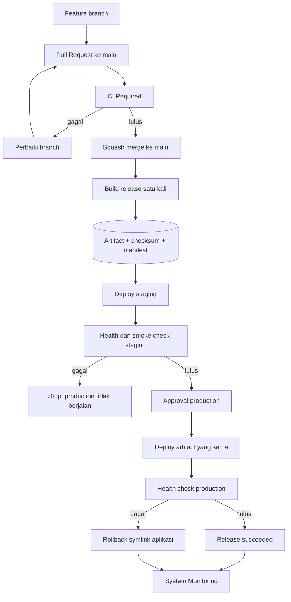

# CI/CD dan Release Pipeline Help Bloomery

## 1. Identitas dokumen

| Field | Nilai |
| --- | --- |
| Tanggal baseline | 26 Oktober 2026 |
| Pembaruan terakhir | 27 Oktober 2026 |
| Status | Phase 1 sampai Phase 4 selesai; Phase 5 dalam masa observasi |
| Aplikasi | Help Bloomery |
| Repository | `rizkielfanipr/help-bloomery` |
| Stack | Laravel 13, PHP 8.4, Filament 5, Livewire 4, Pest 4, Node.js 22, Vite 8 |
| Infrastruktur target | GitHub Actions, satu VPS, Nginx, PHP-FPM, Redis, Supervisor, MySQL, Cloudflare R2 |
| Strategi | Trunk-based development, Pull Request ke `main`, build once, atomic release, promote artifact yang sama |

### 1.1 Status implementasi

| Tahap | Status | Bukti |
| --- | --- | --- |
| Audit repository dan runtime | Selesai | `docs/ci-cd-current-state-audit.md` |
| Implementasi workflow CI Pull Request | Selesai | PR #1, squash commit `d66410c9` |
| Build dan Unit test | Selesai | CI run #2 sukses |
| Empat Feature shard | Selesai | Seluruh shard CI run #2 sukses dalam total run 7 menit 12 detik |
| Check agregat `CI Required` | Selesai | Check sukses pada PR #1 |
| Deployment workflow lama setelah merge | Terverifikasi | `Test and deploy` run #63 sukses |
| Production health | Terverifikasi | `/up` menampilkan `Application up` setelah run #63 |
| Phase 1 — CI Pull Request | Selesai | CI tervalidasi dan Ruleset `main` aktif |
| Ruleset `main` | Selesai | `Protect main` (`25804747`) aktif dengan required check `CI Required` |
| Audit deployment VPS | Selesai | Runtime, Nginx, Supervisor, cron, backup, permission, disk, dan script deploy lama telah diverifikasi |
| GitHub Environment | Selesai | Environment `production` memakai required reviewer dan hanya menerima protected branch |
| Artifact dan atomic release | Selesai | PR #3 (`7a10c0ae`) dan perbaikan monitoring PR #4 (`8f1353f8`) |
| Bootstrap server staging | Selesai | Nginx memakai `/var/www/bloomery/staging/current/public`; shared `.env` dan `storage` aktif |
| Validasi atomic staging | Selesai | Release #2, #3, dan #4 sukses; rollback #4→#3→#4 sehat |
| Phase 2 — Atomic staging | Selesai | Exit criteria tiga deployment dan satu simulasi rollback tercapai |
| Uji restore backup | Selesai | Backup production 26 Oktober 2026 berhasil direstore terisolasi: 191 tabel, 338 migration, dan seluruh `mysqlcheck` OK |
| Phase 3 — Promotion pipeline | Selesai | Release #6 membuktikan jalur reject; Release #7 membuktikan jalur approve dan checksum tanpa deployment production |
| Bootstrap atomic production | Selesai | Initial release `9-eedb7d04`, shared `.env`/storage, preflight lokal, serta rollback runtime tervalidasi |
| Cutover production | Selesai | Nginx, Supervisor, dan scheduler memakai `/var/www/bloomery/production/current` |
| Atomic production pipeline | Selesai | Release #10 mempromosikan artifact staging ke production; monitoring mencatat `succeeded`, migration `ran`, dan health `healthy` |
| Phase 4 — Atomic production | Selesai | Public health/login HTTP 200, queue worker aktif, Redis sehat, dan disk 14% setelah release #10 |

Dokumen ini menjadi sumber acuan untuk membangun ulang CI/CD Help Bloomery dari sisi repository, GitHub, server, deployment, monitoring, rollback, dan operasi harian.

Dokumen ini tidak memberikan izin untuk:

- mengubah konfigurasi production;
- mengubah Nginx, Supervisor, cron, firewall, DNS, atau credential;
- menjalankan migration production;
- menghapus branch `staging`;
- mengaktifkan branch protection;
- menghapus workflow lama;
- melakukan deployment atau rollback production.

Setiap tindakan tersebut tetap memerlukan persetujuan eksplisit dan harus mengikuti tahapan rollout di dokumen ini.

---

## 2. Ringkasan keputusan

Arsitektur target menggunakan keputusan berikut:

1. `main` menjadi satu-satunya source of truth kode yang siap dirilis.
2. Perubahan masuk melalui feature branch dan Pull Request ke `main`.
3. Branch `staging` tidak lagi menjadi tahapan wajib; staging menjadi GitHub Environment dan target server.
4. Pull Request menjalankan CI lengkap tanpa melakukan deployment.
5. Setelah merge ke `main`, pipeline membuat satu artifact release.
6. Artifact yang sama dideploy ke staging, diverifikasi, kemudian dipromosikan ke production.
7. Production memerlukan approval GitHub Environment.
8. Server tidak lagi menjalankan `git pull` pada document root aktif.
9. Setiap deployment menggunakan release directory dan pergantian symlink secara atomik.
10. Health check gagal setelah aktivasi akan mengembalikan symlink ke release sebelumnya.
11. Migration database tidak di-rollback otomatis. Perubahan schema harus backward-compatible dan diperbaiki dengan forward fix.
12. Deployment dicatat melalui System Monitoring yang sudah tersedia.

---

## 3. Baseline sistem sekarang

Pada baseline 25 Oktober 2026, repository memiliki satu workflow `.github/workflows/deploy.yml` dengan karakteristik berikut:

- dipicu hanya oleh `push` ke `main` dan `staging`;
- test dan frontend build dilakukan sebelum deployment;
- production otomatis dideploy setelah push `main` dan test lulus;
- staging otomatis dideploy setelah push `staging` dan test lulus;
- deployment dilakukan dengan SSH dan command `deploy production` atau `deploy staging` di VPS;
- host key SSH diverifikasi melalui `VPS_KNOWN_HOSTS`;
- permission GitHub token sudah minimum, yaitu `contents: read`;
- deployment staging dan production menggunakan satu concurrency group;
- full feature test dapat dilewati melalui pesan commit `[skip full tests]`;
- build CI tidak dipromosikan sebagai artifact yang sama ke server;
- belum ada trigger `pull_request`;
- GitHub Ruleset repository belum tersedia pada saat audit;
- riwayat Pull Request repository masih kosong pada saat audit;
- implementasi command `deploy` berada di VPS dan belum dapat diaudit dari repository;
- belum ada health check dan rollback yang terlihat di workflow GitHub Actions.

Workflow run `aba7a2c0` pada 23 Oktober 2026 memberikan baseline durasi:

| Tahap | Durasi baseline |
| --- | ---: |
| Setup, dependency, build, unit test | sekitar 30 detik |
| Feature test serial | sekitar 19 menit 29 detik |
| Total CI | sekitar 20 menit |
| Deployment production | sekitar 38 detik |

### 3.1 Risiko baseline

| Risiko | Dampak |
| --- | --- |
| CI baru berjalan setelah kode masuk `main` | Error ditemukan setelah source of truth production berubah |
| Direct push ke `main` | Tidak ada checkpoint diff, review, dan required check sebelum merge |
| `[skip full tests]` dari commit message | Author commit dapat melewati sebagian besar regresi feature |
| VPS memakai working tree aktif | Build dapat membuat tracked file berubah dan deployment berikutnya gagal |
| Build CI dibuang | Kode yang diuji tidak terbukti identik dengan kode yang dideploy |
| Script deploy hanya ada di VPS | Perubahan deployment tidak memiliki review, histori, dan test repository |
| Tidak ada post-deploy health gate | Workflow dapat sukses walaupun aplikasi baru tidak sehat |
| Tidak ada rollback otomatis | Pemulihan mengandalkan intervensi manual saat insiden |
| Branch `staging` jangka panjang | Risiko divergence dan pekerjaan promosi dua kali |

---

## 4. Tujuan dan non-tujuan

### 4.1 Tujuan

1. Kode tidak dapat masuk `main` tanpa Pull Request dan CI yang lulus.
2. CI Pull Request selesai dalam target awal 5–8 menit.
3. Artifact production sama persis dengan artifact yang diverifikasi di staging.
4. Deployment tidak bergantung pada kebersihan Git working tree VPS.
5. Aktivasi release dilakukan atomik dan dapat dikembalikan dalam hitungan menit.
6. Migration, cache, queue, scheduler, dan permission tetap konsisten setelah deployment.
7. Status deployment dan commit aktif tercatat di System Monitoring.
8. Secret tidak masuk repository, artifact, log, atau output workflow.
9. Alur tetap sederhana dan sesuai skala satu aplikasi Laravel pada satu VPS.

### 4.2 Non-tujuan

- Mengadopsi Kubernetes, Docker Swarm, atau microservices.
- Memindahkan aplikasi ke platform hosting baru.
- Mengganti MySQL, Redis, R2, Nginx, atau Supervisor.
- Menulis ulang aplikasi atau frontend.
- Membuat zero-downtime migration untuk perubahan schema yang tidak backward-compatible.
- Mengotomatisasi rollback database.

---

## 5. Arsitektur target



### 5.1 Prinsip build once, promote many

Pipeline hanya membuat artifact satu kali untuk satu commit `main`. Staging dan production harus menerima:

- archive yang sama;
- checksum SHA-256 yang sama;
- commit SHA yang sama;
- dependency lock yang sama;
- asset frontend yang sama.

Tidak diperbolehkan menjalankan `composer update`, `npm install`, atau build frontend ulang di production.

---

## 6. Model branch dan Pull Request

### 6.1 Branch

| Branch | Fungsi | Masa hidup |
| --- | --- | --- |
| `main` | Source of truth release | Permanen |
| `feature/<nama>` | Fitur atau perubahan terencana | Dihapus setelah merge |
| `fix/<nama>` | Bug fix biasa | Dihapus setelah merge |
| `hotfix/<nama>` | Perbaikan production mendesak | Dihapus setelah merge |

Branch `staging` dipertahankan selama masa transisi. Branch tersebut baru dihapus setelah pipeline baru berhasil digunakan untuk beberapa release dan rollback sudah diuji.

### 6.2 Alur developer

```bash
git switch main
git pull --ff-only origin main
git switch -c feature/nama-perubahan

# Kerjakan perubahan, test, commit
git push -u origin feature/nama-perubahan
```

Kemudian buat Pull Request menuju `main`.

### 6.3 Aturan merge

- Gunakan squash merge agar satu PR menghasilkan satu commit release yang jelas.
- Judul PR menjadi pesan commit squash.
- Hapus branch otomatis setelah merge.
- Jangan force-push ke `main`.
- Jangan merge ketika required check belum lulus.
- Jangan memakai instruksi skip CI pada commit atau judul PR.

### 6.4 Template Pull Request

Target file: `.github/pull_request_template.md`.

```markdown
## Ringkasan

- Perubahan:
- Alasan:

## Risiko

- Modul terdampak:
- Migration:
- Queue/scheduler:
- Integrasi eksternal:

## Verifikasi

- [ ] Test terdampak ditambahkan/diperbarui
- [ ] CI lulus
- [ ] Tidak ada secret atau data production
- [ ] Migration backward-compatible
- [ ] Rollback aplikasi dipahami

## Uji staging

- Langkah:
- Hasil yang diharapkan:
```

---

## 7. Struktur file repository target

```text
.github/
├── workflows/
│   ├── ci.yml
│   └── release.yml
├── pull_request_template.md
└── dependabot.yml

ops/
├── ci/
│   └── feature-shard.sh
└── deploy/
    ├── deploy-release.sh
    ├── rollback-release.sh
    ├── health-check.sh
    └── README.md

docs/
└── ci-cd-release-pipeline.md
```

Folder baru tersebut dibuat saat implementasi, bukan pada tahap dokumentasi ini.

---

## 8. Workflow CI Pull Request

### 8.1 Trigger

`ci.yml` berjalan untuk:

- Pull Request menuju `main`;
- update commit pada Pull Request;
- `merge_group` bila merge queue diaktifkan kelak;
- `workflow_dispatch` untuk diagnosis manual tanpa deployment.

```yaml
name: CI

on:
  pull_request:
    branches: [main]
  merge_group:
  workflow_dispatch:

permissions:
  contents: read

concurrency:
  group: ci-${{ github.event.pull_request.number || github.ref }}
  cancel-in-progress: true
```

### 8.2 Job yang diperlukan

| Job | Fungsi |
| --- | --- |
| `build-unit` | Composer validation, dependency install, frontend build, unit test |
| `feature` | Feature test dalam empat shard paralel |
| `ci-required` | Check agregat tunggal untuk GitHub Ruleset |

### 8.3 Environment testing

Gunakan nilai non-production seperti workflow sekarang:

```yaml
env:
  APP_ENV: testing
  APP_KEY: base64:AAAAAAAAAAAAAAAAAAAAAAAAAAAAAAAAAAAAAAAAAAA=
  APP_DEBUG: true
  APP_URL: https://help-bloomery.test
  APP_DOMAIN: casual.help-bloomery.test
  DB_CONNECTION: sqlite
  DB_DATABASE: ':memory:'
  CACHE_STORE: array
  SESSION_DRIVER: array
  QUEUE_CONNECTION: sync
  MAIL_MAILER: array
  R2_ACCESS_KEY_ID: testing
  R2_SECRET_ACCESS_KEY: testing
  R2_BUCKET: testing
  R2_ENDPOINT: https://testing.invalid
  RND_PROJECT_TASK_ATTACHMENT_DISK: b2
  ESB_CORE_USERNAME: testing
  ESB_CORE_PASSWORD: testing
  ESB_MASTER_PRODUCT_TOKEN: testing
```

Tidak boleh menggunakan secret production dalam CI test.

### 8.4 Build dan unit test

Contoh struktur job:

```yaml
jobs:
  build-unit:
    name: Build and unit tests
    runs-on: ubuntu-latest
    timeout-minutes: 15
    steps:
      - uses: actions/checkout@<VERIFIED_FULL_COMMIT_SHA> # v7
      - uses: shivammathur/setup-php@<VERIFIED_FULL_COMMIT_SHA> # v2
        with:
          php-version: '8.4'
          coverage: none
          tools: composer:v2
      - uses: actions/setup-node@<VERIFIED_FULL_COMMIT_SHA> # v7
        with:
          node-version: '22'
          cache: npm
      - run: cp .env.example .env
      - run: composer validate --strict
      - run: composer install --prefer-dist --no-interaction --no-progress
      - run: npm ci
      - run: npm run build
      - run: php artisan test --compact --testsuite=Unit
      - uses: actions/upload-artifact@<VERIFIED_FULL_COMMIT_SHA>
        with:
          name: ci-public-build
          path: public/build
          retention-days: 1
          if-no-files-found: error
```

SHA action harus diambil dari release resmi masing-masing action. Jangan menyalin placeholder secara literal. GitHub merekomendasikan full commit SHA karena merupakan referensi immutable.

### 8.5 Feature test paralel

Jangan memakai `[skip full tests]`. Bagi daftar file secara deterministik menjadi empat job. Setiap job menjalankan bagiannya dalam batch kecil agar proses Pest tidak perlu menginventaris seluruh suite sekaligus:

```yaml
  feature:
    name: Feature shard ${{ matrix.shard }}
    needs: build-unit
    runs-on: ubuntu-latest
    timeout-minutes: 15
    strategy:
      fail-fast: false
      matrix:
        shard: [1, 2, 3, 4]
    steps:
      - uses: actions/checkout@<VERIFIED_FULL_COMMIT_SHA>
      - uses: shivammathur/setup-php@<VERIFIED_FULL_COMMIT_SHA>
        with:
          php-version: '8.4'
          coverage: none
          tools: composer:v2
      - run: cp .env.example .env
      - run: composer install --prefer-dist --no-interaction --no-progress
      - uses: actions/download-artifact@<VERIFIED_FULL_COMMIT_SHA>
        with:
          name: ci-public-build
          path: public/build
      - name: Run deterministic feature shard
        shell: bash
        env:
          SHARD_INDEX: ${{ matrix.shard }}
          SHARD_TOTAL: 4
        run: bash ops/ci/feature-shard.sh
```

Kontrak `ops/ci/feature-shard.sh`:

```bash
#!/usr/bin/env bash
set -Eeuo pipefail

feature_tests=()

while IFS= read -r -d '' test_file; do
    feature_tests+=("$test_file")
done < <(find tests/Feature -type f -name '*.php' -print0 | sort -z)

selected_tests=()
selected_remainder=$((SHARD_INDEX - 1))

for ((batch_start = 0; batch_start < ${#feature_tests[@]}; batch_start += 20)); do
    batch_number=$((batch_start / 20))

    if (( batch_number % SHARD_TOTAL == selected_remainder )); then
        batch=("${feature_tests[@]:batch_start:20}")
        selected_tests+=("${batch[@]}")
    fi
done

for ((batch_start = 0; batch_start < ${#selected_tests[@]}; batch_start += 20)); do
    batch=("${selected_tests[@]:batch_start:20}")
    php artisan test --compact "${batch[@]}"
done
```

Script aktual wajib memvalidasi bahwa index, total shard, dan ukuran batch merupakan bilangan bulat positif, index tidak melebihi total, serta direktori `tests/Feature` tersedia.

Pembagian dilakukan pada kelompok berurutan yang masing-masing berisi maksimal 20 file. Kelompok tersebut kemudian dibagikan secara modulo ke empat shard. Strategi ini menjamin seluruh file test masuk tepat satu shard sambil mempertahankan kombinasi dan urutan batch workflow lama. Setelah pipeline stabil, distribusi dapat diubah menjadi manifest berbobot berdasarkan histori durasi bila waktu antar-shard tidak seimbang.

### 8.6 Required check agregat

```yaml
  ci-required:
    name: CI Required
    if: always()
    needs: [build-unit, feature]
    runs-on: ubuntu-latest
    steps:
      - name: Verify required jobs
        env:
          BUILD_RESULT: ${{ needs.build-unit.result }}
          FEATURE_RESULT: ${{ needs.feature.result }}
        run: |
          test "$BUILD_RESULT" = success
          test "$FEATURE_RESULT" = success
```

GitHub Ruleset hanya perlu mewajibkan check `CI Required`. Nama tersebut harus stabil.

### 8.7 Target performa CI

| Metrik | Target awal |
| --- | ---: |
| Build + unit | ≤ 3 menit |
| Shard feature paling lambat | ≤ 8 menit |
| Total waktu PR | ≤ 10 menit |
| Flaky retry | 0 sebagai target; retry bukan pengganti perbaikan |

Jika satu shard jauh lebih lambat, ubah pembagian dari modulo file menjadi manifest berbobot berdasarkan histori durasi.

---

## 9. Workflow release setelah merge

### 9.1 Trigger dan concurrency

`release.yml` berjalan hanya pada push ke `main` dan manual rollback yang terpisah.

```yaml
name: Release

on:
  push:
    branches: [main]

permissions:
  contents: read

concurrency:
  group: bloomery-release
  cancel-in-progress: false
```

Jangan menggunakan `pull_request_target` untuk build atau deployment kode Pull Request karena event tersebut memiliki risiko akses secret pada kode yang belum dipercaya.

### 9.2 Job release

```text
build-release
      ↓
deploy-staging
      ↓
verify-staging
      ↓
deploy-production (environment approval)
      ↓
verify-production
```

### 9.3 Build release artifact

Artifact wajib dibuat dari `github.sha` dan memuat:

- source Laravel;
- `vendor/` dari `composer.lock`;
- `public/build/` dari `package-lock.json`;
- file manifest deployment;
- tidak memuat `.env`, `.git`, `node_modules`, log, storage runtime, atau cache environment CI.

Contoh manifest:

```json
{
  "application": "help-bloomery",
  "commit": "FULL_GITHUB_SHA",
  "run_id": "GITHUB_RUN_ID",
  "run_number": "GITHUB_RUN_NUMBER",
  "built_at": "ISO_8601_UTC",
  "php": "8.4",
  "node": "22"
}
```

Contoh langkah build:

```yaml
  build-release:
    name: Build release artifact
    runs-on: ubuntu-latest
    timeout-minutes: 15
    steps:
      - uses: actions/checkout@<VERIFIED_FULL_COMMIT_SHA>
      - uses: shivammathur/setup-php@<VERIFIED_FULL_COMMIT_SHA>
        with:
          php-version: '8.4'
          coverage: none
          tools: composer:v2
      - uses: actions/setup-node@<VERIFIED_FULL_COMMIT_SHA>
        with:
          node-version: '22'
          cache: npm
      - run: cp .env.example .env
      - run: composer install --no-dev --prefer-dist --no-interaction --no-progress --optimize-autoloader
      - run: npm ci
      - run: npm run build
      - name: Remove environment-specific cache
        run: php artisan optimize:clear
      - name: Create release manifest and archive
        run: bash ops/deploy/build-artifact.sh
      - uses: actions/upload-artifact@<VERIFIED_FULL_COMMIT_SHA>
        with:
          name: release-${{ github.sha }}
          path: |
            dist/help-bloomery-${{ github.sha }}.tar.gz
            dist/help-bloomery-${{ github.sha }}.tar.gz.sha256
          retention-days: 30
          if-no-files-found: error
```

`build-artifact.sh` wajib gagal jika archive memuat `.env` atau `.git`.

### 9.4 Artifact checksum

Sebelum upload dan setelah download:

```bash
sha256sum "help-bloomery-${GITHUB_SHA}.tar.gz" > "help-bloomery-${GITHUB_SHA}.tar.gz.sha256"
sha256sum --check "help-bloomery-${GITHUB_SHA}.tar.gz.sha256"
```

Archive dengan checksum tidak cocok tidak boleh diekstrak atau diaktifkan.

---

## 10. GitHub Environments dan secrets

### 10.1 Environment `staging`

- hanya branch `main` yang boleh deploy;
- tidak memerlukan approval;
- menggunakan domain, path, dan konfigurasi staging;
- tidak boleh menggunakan database atau credential production;
- menjalankan health check sebelum pipeline menuju production.

### 10.2 Environment `production`

- hanya branch `main` yang boleh deploy;
- gunakan required reviewer bila ada orang kedua;
- jika hanya satu maintainer, approval deployment oleh maintainer tetap dipakai, tetapi jangan aktifkan `prevent self-review`;
- nonaktifkan bypass protection bila operasional tim sudah siap;
- secret baru tersedia setelah approval environment.

### 10.3 Daftar secret per environment

| Secret | Fungsi |
| --- | --- |
| `VPS_HOST` | Host/IP VPS |
| `VPS_USER` | User deploy non-root |
| `VPS_SSH_KEY` | Private key khusus CI/CD |
| `VPS_KNOWN_HOSTS` | Host key VPS yang diverifikasi manual |
| `DEPLOY_BASE_PATH` | Base path environment target |
| `APP_HEALTH_URL` | URL `/up` environment |

Jika staging dan production berada di VPS yang sama, private key boleh sama pada fase awal, tetapi base path, `.env`, database, domain, dan environment secret tetap terpisah.

Secret aplikasi seperti database, Redis, ESB, R2, Telegram, dan mail tetap berada dalam `.env` server. Jangan memindahkan seluruh `.env` production ke GitHub jika tidak diperlukan.

### 10.4 Kebijakan keamanan Actions

- `GITHUB_TOKEN` menggunakan `contents: read` kecuali ada kebutuhan tertulis.
- Semua third-party action dipin ke full commit SHA terverifikasi.
- Dependabot memantau `github-actions`, Composer, dan NPM.
- Jangan menampilkan secret, `.env`, private key, atau payload credential di log.
- Jangan menjalankan kode Pull Request tidak tepercaya dalam job yang memiliki environment secret.
- Artifact hanya dihasilkan dari protected `main`.

Referensi resmi:

- [Secure use reference](https://docs.github.com/en/actions/reference/security/secure-use)
- [Workflow artifacts](https://docs.github.com/en/actions/concepts/workflows-and-actions/workflow-artifacts)
- [Deployment environments](https://docs.github.com/en/actions/reference/workflows-and-actions/deployments-and-environments)

---

## 11. Struktur direktori VPS target

Gunakan struktur terpisah per environment:

```text
/var/www/bloomery/
├── production/
│   ├── current -> releases/1042-abcdef12
│   ├── releases/
│   │   ├── 1040-12345678/
│   │   ├── 1041-98765432/
│   │   └── 1042-abcdef12/
│   ├── shared/
│   │   ├── .env
│   │   └── storage/
│   ├── incoming/
│   └── .deploy.lock
└── staging/
    ├── current -> releases/1042-abcdef12
    ├── releases/
    ├── shared/
    │   ├── .env
    │   └── storage/
    ├── incoming/
    └── .deploy.lock
```

Gunakan `GITHUB_RUN_NUMBER` dan short SHA dalam nama release agar urutan release dapat dibaca manusia dan stale deployment dapat ditolak.

---

## 12. Bootstrap VPS satu kali

Semua command berikut adalah template. Target, user, group, versi service, dan path harus diverifikasi di VPS sebelum dijalankan.

### 12.1 User dan direktori

```bash
sudo install -d -o deploy -g www-data -m 2750 /var/www/bloomery

for environment_name in production staging; do
    sudo install -d -o deploy -g www-data -m 2750 "/var/www/bloomery/${environment_name}"
    sudo install -d -o deploy -g www-data -m 2750 "/var/www/bloomery/${environment_name}/releases"
    sudo install -d -o deploy -g www-data -m 2750 "/var/www/bloomery/${environment_name}/incoming"
    sudo install -d -o deploy -g www-data -m 2750 "/var/www/bloomery/${environment_name}/shared"
    sudo install -d -o deploy -g www-data -m 2770 "/var/www/bloomery/${environment_name}/shared/storage"
done
```

Hindari permission `777`. User `deploy` memiliki release, sedangkan `www-data` hanya memerlukan akses baca aplikasi dan tulis pada `storage` serta `bootstrap/cache`.

### 12.2 Shared environment

Salin `.env` existing secara manual ke:

```text
/var/www/bloomery/production/shared/.env
/var/www/bloomery/staging/shared/.env
```

Set permission minimum:

```bash
sudo chown deploy:www-data /var/www/bloomery/production/shared/.env
sudo chmod 640 /var/www/bloomery/production/shared/.env
```

Ulangi untuk staging. Jangan menampilkan isi `.env` di terminal recording, GitHub log, atau dokumentasi.

### 12.3 PHP dan service

Verifikasi:

```bash
php -v
php -m
composer --version
redis-cli ping
sudo systemctl status php8.4-fpm
sudo systemctl status nginx
sudo supervisorctl status
```

Artifact sudah memuat `vendor` dan `public/build`, sehingga Node.js dan Composer tidak wajib tersedia untuk deployment normal. Composer tetap berguna untuk diagnosis, tetapi tidak digunakan untuk membangun ulang release production.

### 12.4 Sudo minimum

Jika deployment perlu reload PHP-FPM, berikan sudo terbatas hanya untuk command tersebut. Jangan memberikan `NOPASSWD: ALL` kepada user deploy.

Contoh konsep `/etc/sudoers.d/bloomery-deploy`:

```sudoers
deploy ALL=(root) NOPASSWD: /usr/bin/systemctl reload php8.4-fpm
```

Path binary wajib diperiksa dengan `command -v systemctl` sebelum membuat rule.

---

## 13. Nginx

Document root harus menunjuk ke symlink `current/public`, bukan release tertentu:

```nginx
server {
    server_name office.bloomery.co.id;
    root /var/www/bloomery/production/current/public;

    index index.php;
    charset utf-8;

    location / {
        try_files $uri $uri/ /index.php?$query_string;
    }

    location = /up {
        access_log off;
        try_files $uri /index.php?$query_string;
    }

    location ~ ^/index\.php(/|$) {
        include fastcgi_params;
        fastcgi_pass unix:/run/php/php8.4-fpm.sock;
        fastcgi_param SCRIPT_FILENAME $realpath_root$fastcgi_script_name;
    }

    location ~ /\.(?!well-known).* {
        deny all;
    }
}
```

`$realpath_root` penting agar PHP-FPM menggunakan target symlink release yang aktif. Konfigurasi staging memakai domain dan path staging.

Sebelum reload:

```bash
sudo nginx -t
sudo systemctl reload nginx
```

---

## 14. Supervisor dan queue worker

Contoh production:

```ini
[program:bloomery-production-worker]
process_name=%(program_name)s_%(process_num)02d
command=/usr/bin/php /var/www/bloomery/production/current/artisan queue:work redis --queue=default --sleep=3 --tries=3 --timeout=90 --max-time=3600
directory=/var/www/bloomery/production/current
autostart=true
autorestart=true
stopasgroup=true
killasgroup=true
user=deploy
numprocs=2
redirect_stderr=true
stdout_logfile=/var/www/bloomery/production/shared/storage/logs/worker.log
stopwaitsecs=3600
```

Ketentuan:

- `stopwaitsecs` harus lebih besar daripada job terlama;
- `retry_after` queue harus lebih besar daripada `timeout` worker;
- worker berjalan melalui Supervisor, bukan terminal interaktif;
- deployment menjalankan `php artisan queue:restart` setelah symlink berpindah;
- Supervisor memulai worker baru dari `current` yang baru.

Jika Laravel 13 `php artisan reload` sudah diverifikasi aman untuk seluruh service panjang yang digunakan, command tersebut dapat menggantikan restart granular. Implementasi awal tetap boleh menggunakan `queue:restart` agar perubahan lebih kecil.

---

## 15. Scheduler

Gunakan satu cron per environment yang memang memerlukan scheduler:

```cron
* * * * * cd /var/www/bloomery/production/current && /usr/bin/php artisan schedule:run >> /dev/null 2>&1
```

Pastikan staging tidak menjalankan job production, notifikasi nyata, atau transaksi ESB production. Bila scheduler staging diperlukan untuk pengujian, gunakan credential dan feature flag staging.

---

## 16. Kontrak script deployment

Target script: `ops/deploy/deploy-release.sh`.

### 16.1 Input wajib

```text
deploy-release.sh <environment> <run-number> <full-sha> <archive> <checksum>
```

Validasi:

- environment hanya `staging` atau `production`;
- run number hanya integer positif;
- SHA harus 40 karakter hexadecimal;
- archive dan checksum harus file reguler di folder `incoming` environment;
- checksum harus valid;
- release number tidak boleh lebih tua dari release aktif kecuali mode rollback eksplisit;
- tidak menerima path arbitrary dari input tanpa canonical-path validation.

### 16.2 Urutan deployment

1. Aktifkan `set -Eeuo pipefail`.
2. Ambil lock eksklusif menggunakan `flock`.
3. Verifikasi checksum artifact.
4. Baca manifest dan cocokkan commit/run number.
5. Simpan target symlink release sebelumnya.
6. Ekstrak ke release directory baru dengan `--no-same-owner`.
7. Pastikan artifact tidak memiliki `.env`, `.git`, atau link keluar dari release directory.
8. Hubungkan `.env` ke `shared/.env`.
9. Hubungkan `storage` ke `shared/storage`.
10. Buat `bootstrap/cache` dan permission yang diperlukan.
11. Jalankan pre-activation checks.
12. Jalankan migration dengan release baru tetapi `.env` shared.
13. Reset permission cache dan jalankan seeder permission idempotent bila diwajibkan aplikasi.
14. Jalankan `php artisan optimize`.
15. Aktifkan symlink secara atomik.
16. Gracefully restart queue worker.
17. Reload PHP-FPM bila OPcache memerlukannya.
18. Jalankan local dan HTTP health check.
19. Catat deployment sukses di System Monitoring.
20. Simpan lima release terakhir dan bersihkan yang lebih lama.
21. Hapus artifact dari `incoming` setelah release terbukti sehat.

### 16.3 Command aplikasi

Urutan awal yang direkomendasikan:

```bash
php artisan optimize:clear
php artisan migrate --force
php artisan db:seed --class=RolesAndPermissionsSeeder --force
php artisan permission:cache-reset
php artisan optimize
```

Catatan:

- `optimize:clear` pada release baru membersihkan cache file release tersebut;
- `php artisan optimize` mencakup cache production Laravel;
- pastikan tidak ada pemanggilan `env()` di luar file config sebelum mengaktifkan config cache;
- seeder permission hanya dipertahankan jika telah dibuktikan idempotent;
- migration destruktif tidak boleh digabung dengan release biasa.

### 16.4 Aktivasi symlink atomik

Konsep Linux:

```bash
ln -s "${release_path}" "${base_path}/current.next"
mv -Tf "${base_path}/current.next" "${base_path}/current"
```

Jangan menghapus `current` lebih dahulu karena akan menciptakan jendela document root tanpa aplikasi.

### 16.5 Deployment lock

```bash
exec 9>"${base_path}/.deploy.lock"
flock -n 9 || {
    echo "Deployment lain masih berjalan."
    exit 1
}
```

GitHub concurrency dan server `flock` dipakai bersama. GitHub mencegah overlap normal; server lock melindungi dari eksekusi manual atau workflow lain.

---

## 17. Health check dan smoke test

### 17.1 Health check minimum

Laravel sudah menyediakan `/up` melalui `bootstrap/app.php`.

```bash
curl --fail --silent --show-error --max-time 10 "${APP_HEALTH_URL}"
```

Laravel `/up` membuktikan aplikasi dapat boot. Tambahkan verifikasi server-side:

```bash
php artisan migrate:status --no-interaction
php artisan app:check-redis
php artisan monitoring:run-checks
```

`monitoring:run-checks` tidak boleh membuat transaksi bisnis ke ESB. Konfigurasi monitoring environment harus memastikan check eksternal aman dan read-only.

### 17.2 Smoke route

Smoke test HTTP production minimal:

- `/up` mengembalikan 200;
- halaman login merespons tanpa 5xx;
- asset manifest tersedia;
- response berasal dari commit yang baru melalui System Monitoring.

Route bisnis yang memerlukan login diuji melalui test suite, bukan dengan menyimpan credential pengguna production di GitHub Actions.

### 17.3 Retry health check

Gunakan retry terbatas, misalnya 6 kali dengan jeda 5 detik. Total grace period 30 detik. Jika tetap gagal, deployment dianggap gagal.

---

## 18. System Monitoring deployment record

Proyek sudah memiliki command:

```bash
php artisan monitoring:record-deployment
```

### 18.1 Saat mulai

```bash
php artisan monitoring:record-deployment \
  --environment=production \
  --provider=github_actions \
  --run-id="${GITHUB_RUN_ID}" \
  --status=started \
  --stage=deploying \
  --branch=main \
  --commit="${GITHUB_SHA}" \
  --actor="${GITHUB_ACTOR}"
```

### 18.2 Saat berhasil

```bash
php artisan monitoring:record-deployment \
  --environment=production \
  --provider=github_actions \
  --run-id="${GITHUB_RUN_ID}" \
  --status=succeeded \
  --stage=completed \
  --branch=main \
  --commit="${GITHUB_SHA}" \
  --migration-status=succeeded \
  --health-status=healthy \
  --finished-at="$(date --iso-8601=seconds)"
```

### 18.3 Saat gagal

Catat ringkasan yang telah disanitasi. Jangan memasukkan stack trace, `.env`, SQL sensitif, token, atau output command yang dapat mengandung credential.

`MONITORING_DEPLOY_COMMIT` sebaiknya dibiarkan kosong bila aplikasi menggunakan deployment record terakhir yang sukses sebagai commit aktif. Jika environment variable tersebut diisi statis, nilainya harus ikut diperbarui secara aman pada setiap release.

---

## 19. Rollback aplikasi

### 19.1 Kapan rollback otomatis dijalankan

- `/up` gagal setelah release diaktifkan;
- aplikasi tidak dapat boot;
- PHP-FPM gagal memuat release;
- manifest/asset penting tidak tersedia;
- local health check kritis gagal.

### 19.2 Prosedur rollback symlink

1. Ambil deployment lock.
2. Pastikan target previous release masih ada.
3. Ubah `current` secara atomik ke previous release.
4. Restart queue worker.
5. Reload PHP-FPM bila diperlukan.
6. Jalankan health check previous release.
7. Catat deployment gagal dan rollback di System Monitoring.
8. Jangan hapus release gagal sampai investigasi selesai.

### 19.3 Batas rollback

Rollback aplikasi tidak mengembalikan:

- migration database;
- data yang sudah ditulis pengguna;
- transaksi yang sudah dikirim ke ESB;
- job yang sudah dijalankan;
- attachment yang sudah diunggah.

Karena itu seluruh migration reguler wajib menggunakan pola expand/contract:

1. **Expand:** tambah tabel/kolom/index tanpa menghapus kontrak lama.
2. Deploy kode yang dapat membaca kondisi lama dan baru.
3. Backfill data secara idempotent bila diperlukan.
4. Pindahkan seluruh pembaca/penulis ke struktur baru.
5. **Contract:** hapus struktur lama pada release terpisah setelah observasi.

Migration rename/drop, perubahan tipe berisiko, atau backfill besar harus memiliki runbook dan maintenance window tersendiri.

---

## 20. Backup dan pemulihan

Sebelum release dengan migration berisiko:

- buat backup database di luar server utama;
- verifikasi ukuran dan checksum backup;
- pastikan backup dapat dibaca;
- catat waktu backup dan commit tujuan;
- jangan menganggap file backup valid sebelum restore pernah diuji di staging.

Target dari `docs/application-stability-scalability-prd.md` tetap berlaku:

- RPO awal 24 jam;
- RTO awal 4 jam;
- retensi awal 7 harian, 4 mingguan, dan 6 bulanan;
- uji restore setiap 1–3 bulan.

Artifact release bukan backup database dan bukan backup attachment R2.

### 20.1 Retensi binary log production

Pada 27 Oktober 2026, 617 binary log menggunakan 63,19 GB dan membuat filesystem mencapai 98%.
Tidak ada replica aktif. Setelah backup terbaru diverifikasi dan satu backup berhasil diuji restore,
log lama dipurge melalui MySQL, database restore sementara dihapus, dan penggunaan disk turun menjadi
13–14%.

Binary logging tetap aktif untuk point-in-time recovery. Konfigurasi persisten production adalah:

```text
binlog_expire_logs_auto_purge=ON
binlog_expire_logs_seconds=86400
```

Artinya jendela binary log lokal ditargetkan 24 jam. Jangan menghapus `binlog.*` langsung dari
filesystem; gunakan `PURGE BINARY LOGS`. Pertumbuhan disk dan tabel dengan aktivitas write tertinggi
harus terus dipantau karena retensi tidak memperbaiki sumber write yang abnormal.

---

## 21. GitHub Ruleset `main`

Setelah `CI Required` pernah berhasil minimal satu kali, buat ruleset active untuk default branch.

**Status implementasi:** selesai pada 25 Oktober 2026. Ruleset `Protect main` (`25804747`) aktif dan aturan efektif branch `main` sudah diverifikasi melalui GitHub API.

### 21.1 Target

- Include default branch (`main`).

### 21.2 Rules minimum

- Restrict deletions.
- Block force pushes.
- Require a pull request before merging.
- Required approvals: `0` selama hanya satu maintainer; ubah menjadi `1` saat ada reviewer kedua.
- Require conversation resolution.
- Require status checks before merging.
- Required check: `CI Required`, source GitHub Actions.
- Gunakan strict up-to-date check bila volume PR masih rendah.

### 21.3 Bypass

Pada masa awal, repository owner boleh memiliki bypass untuk pemulihan darurat. Setiap bypass harus:

- hanya digunakan untuk insiden production nyata;
- tetap memiliki issue atau catatan insiden;
- disusul Pull Request normal yang menyamakan histori;
- tidak digunakan untuk mempercepat fitur biasa.

Setelah pipeline stabil dan ada maintainer kedua, ubah bypass menjadi terbatas atau nonaktifkan.

Referensi resmi:

- [Available rules for rulesets](https://docs.github.com/en/repositories/configuring-branches-and-merges-in-your-repository/managing-rulesets/available-rules-for-rulesets)
- [Creating repository rulesets](https://docs.github.com/en/repositories/configuring-branches-and-merges-in-your-repository/managing-rulesets/creating-rulesets-for-a-repository)

---

## 22. Tahapan migrasi dari workflow lama

### Phase 0 — Inventaris dan backup

**Perubahan:** tidak ada mutasi production.

- Salin isi command `deploy production` dan `deploy staging` dari VPS ke catatan privat.
- Catat Nginx root, PHP-FPM socket, user/group, Supervisor, cron, Redis, database, disk, dan permission.
- Catat semua secret GitHub yang aktif tanpa menyalin nilainya.
- Backup database dan `.env` secara aman.
- Pastikan workflow lama masih dapat digunakan sebagai fallback.

**Exit criteria:** alur deployment lama dapat dijelaskan dan dipulihkan.

### Phase 1 — CI Pull Request

- Tambahkan `ci.yml` dan sharding.
- Workflow deploy lama tetap aktif.
- Buat PR percobaan dan ukur durasi.
- Stabilkan test flaky.
- Jangan aktifkan Ruleset sebelum nama required check muncul di GitHub.
- Setelah `CI Required` berhasil, aktifkan Ruleset `main` agar perubahan berikutnya wajib melalui PR dan check tersebut.

**Exit criteria:** tercapai. PR percobaan lulus, `CI Required` tersedia, dan Ruleset `main` aktif.

**Rollback:** ubah Ruleset ke Evaluate/nonaktifkan dan hapus/nonaktifkan `ci.yml`; deployment production belum berubah.

### Phase 2 — Bootstrap release staging

- Buat struktur release staging.
- Pasang Nginx staging menuju `current/public`.
- Pasang Supervisor dan cron staging bila diperlukan.
- Implementasikan artifact build dan script deployment.
- Deploy ke staging tanpa mengubah production.

**Status 26 Oktober 2026:** selesai. PR #3 menambahkan workflow dan script release, kemudian PR #4
memperbaiki kontrak `migration_status` untuk System Monitoring. Staging memakai struktur
`incoming`, `releases`, `shared`, dan symlink `current`; Nginx menunjuk ke `current/public`.
Repository variable `ATOMIC_STAGING_ENABLED=true` mengaktifkan job staging. Release #2, #3, dan #4
berhasil berurutan. Simulasi rollback #4 ke #3 lulus health check, lalu staging dikembalikan ke #4
dan kembali sehat. Workflow deployment production lama tidak diubah.

**Exit criteria:** tercapai. Tiga deployment staging berurutan berhasil dan satu simulasi rollback
berhasil. Uji restore backup database staging tetap wajib sebelum cutover production.

### Phase 3 — Release workflow dengan production tertahan

- Tambahkan `release.yml`.
- Build artifact dari `main`.
- Deploy staging otomatis.
- Konfigurasikan environment production dengan approval tetapi jangan approve dahulu.
- Verifikasi artifact, record monitoring, dan smoke check.

**Status 26 Oktober 2026:** selesai. Push ke `main` membuat artifact satu kali dan mendeploy artifact
tersebut ke atomic staging. Job berikutnya mereferensikan environment `production`, tetapi hanya
mengunduh artifact staging dan memverifikasi checksum. Job tidak mempunyai konfigurasi SSH maupun
command deployment production. Environment `production` telah memakai required reviewer dan aturan
protected branch. Repository variable `PRODUCTION_APPROVAL_REHEARSAL_ENABLED=true` telah diaktifkan.

Workflow lama diubah menjadi `workflow_dispatch` fallback manual. Dengan demikian merge biasa tidak
lagi menjalankan full Feature test serial dan tidak lagi otomatis memanggil `deploy production`.

**Validasi Phase 3:** Release #6 berhenti pada status Waiting dan berhasil direject tanpa mengubah
production. Release #7 berhasil di-approve, memverifikasi checksum artifact, dan mengaktifkan staging
release `7-532bd5a2`. Production tetap sehat pada commit `09d0d5b`; job approval tidak membuka koneksi
SSH dan tidak menjalankan deployment production.

Backup production `bloomery_office_prod_2026-10-26_16-20-42.sql.gz` juga berhasil direstore ke
database sementara tanpa menulis binary log. Restore menghasilkan 191 tabel, 338 migration, 97 user,
dan 28 branch. `mysqlcheck --check --quick` selesai dengan exit code 0 untuk seluruh tabel. Warning
`Integer display width is deprecated` berasal dari sintaks integer lama pada dump dan tidak menggagalkan
restore.

**Exit criteria:** tercapai. Jalur reject dan approve telah diuji, artifact staging terverifikasi,
production tidak berubah, fallback lama hanya manual, dan restore backup berhasil.

**Rollback:** batalkan job production dan gunakan workflow lama.

### Phase 4 — Cutover production

**Status 27 Oktober 2026:** selesai. Workflow production atomik tersedia melalui repository variable
`ATOMIC_PRODUCTION_ENABLED=true`. VPS juga memerlukan marker
`production/shared/atomic-release-enabled`; dua gate independen mencegah aktivasi tidak sengaja.

Lakukan pada waktu traffic rendah:

1. Pastikan backup terbaru tersedia.
2. Buat initial production release dari commit yang sedang aktif.
3. Hubungkan shared `.env` dan `storage`.
4. Uji release melalui hostname lokal atau `curl --resolve` sebelum Nginx cutover.
5. Ubah Nginx root ke `production/current/public`.
6. Jalankan `nginx -t` dan reload.
7. Jalankan health dan smoke check.
8. Approve satu release baru melalui pipeline.
9. Pantau error, queue, scheduler, login, dan route utama.

Initial release `9-eedb7d04` dibuat dari artifact yang sudah sehat di staging. Release tersebut diuji
melalui Nginx lokal `127.0.0.1:18080`: manifest cocok, `/up` HTTP 200, login HTTP 200, dan tidak ada
error PHP-FPM. Konfigurasi Nginx, Supervisor, serta cron dibackup dan rollback script diuji sebelum
cutover.

Setelah cutover, Nginx memakai `production/current/public`, queue worker dan scheduler memakai
`production/current`, sedangkan `.env` dan storage berasal dari shared directory. Local preflight
listener kemudian dinonaktifkan. Release #10 berhasil melalui approval GitHub Environment dan
mengaktifkan `10-eedb7d04`. System Monitoring mencatat provider `github_actions`, status `succeeded`,
stage `completed`, migration `ran`, dan health `healthy`. Disk tetap 14% dan binary log hanya 0,04 GB.

**Exit criteria:** tercapai. Build-once promotion, approval production, atomic activation, runtime
worker/scheduler, health check, deployment monitoring, dan rollback cutover telah diverifikasi.

**Rollback cutover:** kembalikan Nginx root ke path lama dan reload Nginx. Jangan menghapus deployment lama pada hari cutover.

### Phase 5 — Enforcement

- Verifikasi Ruleset `main` tetap aktif dan tidak memiliki bypass reguler.
- Hapus `[skip full tests]` dari workflow lama.
- Hentikan direct push reguler.
- Nonaktifkan workflow deploy lama setelah minimal tiga release production baru sukses.
- Arsipkan command VPS lama.
- Hapus branch `staging` hanya setelah seluruh referensi dan environment policy diperiksa.

---

## 23. Runbook release normal

1. Buat feature branch dari `main` terbaru.
2. Implementasikan perubahan dan affected tests.
3. Push branch dan buat Pull Request.
4. Isi ringkasan, risiko, migration, dan langkah uji.
5. Tunggu `CI Required` lulus.
6. Lakukan squash merge.
7. Pantau build artifact.
8. Pastikan staging deploy dan health check lulus.
9. Uji manual staging bila perubahan berisiko atau menyentuh workflow utama.
10. Approve production environment.
11. Pastikan production health check lulus.
12. Pantau System Monitoring minimal 15 menit untuk release berisiko.

---

## 24. Runbook hotfix

Hotfix tetap menggunakan Pull Request:

1. Buat `hotfix/<nama>` dari `main`.
2. Batasi perubahan hanya pada penyebab insiden.
3. Tambahkan regression test.
4. Jalankan CI lengkap yang sudah diparalelkan.
5. Squash merge.
6. Verifikasi staging otomatis.
7. Approve production segera setelah staging sehat.
8. Pantau error dan transaksi eksternal.

Direct push/bypass hanya dipakai jika waktu CI menimbulkan dampak bisnis lebih besar daripada risiko perubahan. Bypass wajib dicatat sebagai insiden dan diikuti test serta PR setelah sistem pulih.

---

## 25. Operasional harian dan retensi

- Simpan lima release aplikasi terakhir per environment.
- Simpan artifact GitHub selama 30 hari.
- Jangan menghapus current dan previous release.
- Bersihkan `incoming` setelah deployment sehat.
- Pantau penggunaan disk sebelum ekstraksi artifact.
- Rotasi log worker dan aplikasi.
- Audit failed jobs dan heartbeat scheduler.
- Dependabot membuat PR dependency secara berkala; dependency update tetap melalui CI.
- Rotasi SSH key deployment sesuai kebijakan keamanan atau segera setelah dugaan kompromi.

---

## 26. Acceptance criteria

Pipeline baru dinyatakan selesai jika seluruh kondisi berikut terpenuhi:

### Repository dan GitHub

- [x] Pull Request ke `main` menjalankan CI lengkap.
- [x] CI tidak dapat dilewati melalui commit message.
- [x] Empat shard menjalankan seluruh file `tests/Feature` tepat satu kali.
- [x] `CI Required` menjadi required status check.
- [x] Direct push reguler ke `main` ditolak oleh rule `pull_request`; bypass admin dibatasi pada Pull Request.
- [x] Workflow action dipin ke SHA terverifikasi.

### Artifact

- [x] Satu commit menghasilkan satu artifact dan checksum.
- [x] Artifact tidak memuat `.env`, `.git`, `node_modules`, log, atau runtime storage.
- [x] Staging dan production menggunakan checksum yang sama.
- [x] Manifest release cocok dengan GitHub SHA dan run ID.

### Server

- [x] Nginx menggunakan `current/public` dan `$realpath_root`.
- [x] `.env` dan storage berada di shared directory.
- [x] Symlink activation atomik.
- [x] Deployment overlap ditolak oleh `flock`.
- [x] Queue worker restart secara graceful.
- [x] Scheduler tetap aktif setelah symlink berpindah.
- [x] Permission tidak menggunakan `777`.

### Verifikasi dan pemulihan

- [x] `/up` lulus setelah deployment.
- [x] Redis, database, queue, dan scheduler terpantau.
- [x] Deployment tercatat di System Monitoring.
- [x] Simulasi rollback staging dan rollback konfigurasi cutover berhasil.
- [ ] Tim memahami bahwa migration tidak otomatis di-rollback.
- [x] Backup production berhasil direstore dan diperiksa pada database sementara yang terisolasi.

### Performa

- [x] CI Pull Request konsisten ≤ 10 menit atau memiliki rencana optimasi berbasis data.
- [ ] Deployment aplikasi normal ≤ 3 menit di luar waktu approval.
- [ ] Rollback aplikasi ≤ 5 menit.

---

## 27. Risiko implementasi dan mitigasi

| Risiko | Mitigasi |
| --- | --- |
| Artifact terlalu besar | Exclude test/node_modules/cache; monitor ukuran; gunakan compression |
| Vendor berbeda dengan environment | Build memakai PHP 8.4/Linux yang sama dan `composer.lock` |
| Symlink tidak didukung konfigurasi web | Gunakan `$realpath_root`, uji staging, reload PHP-FPM |
| Migration membuat old release tidak kompatibel | Expand/contract dan forward fix |
| Queue memproses kode lama setelah switch | `queue:restart` dan Supervisor |
| Stale release berjalan setelah release baru | Gunakan run number monotonic dan server lock |
| Secret bocor ke artifact/log | Explicit archive allowlist, secret scanning, log sanitization |
| Test shard tidak seimbang | Simpan histori durasi dan gunakan weighted manifest |
| Health `/up` terlalu dangkal | Kombinasikan `/up`, Redis check, migration status, dan System Monitoring |
| Approval production menjadi formalitas | Tampilkan commit, migration, staging result, dan rollback target pada summary |
| Rollback menyembunyikan migration bermasalah | Catat migration status dan gunakan forward fix |

---

## 28. Observability dan GitHub job summary

Setiap release sebaiknya menulis summary GitHub berisi:

- commit SHA dan pesan commit;
- artifact checksum;
- environment;
- release directory;
- previous release;
- migration status;
- health status;
- waktu mulai dan selesai;
- tautan System Monitoring;
- hasil rollback bila terjadi.

Summary tidak boleh memuat host internal sensitif, `.env`, token, database DSN, private path credential, atau payload bisnis.

---

## 29. Rencana pekerjaan implementasi

| ID | Pekerjaan | Ketergantungan | Bukti selesai |
| --- | --- | --- | --- |
| CICD-01 | Inventaris command deploy existing | - | **Sebagian:** repository selesai, command VPS tertunda |
| CICD-02 | Tambah PR template | - | Template muncul pada PR |
| CICD-03 | Tambah `ci.yml` | - | **Selesai:** PR #1 / CI run #2 |
| CICD-04 | Implementasi deterministic sharding | CICD-03 | **Selesai:** 222 file, empat shard lulus |
| CICD-05 | Optimasi cache dependency | CICD-03 | Durasi tercatat lebih rendah |
| CICD-06 | Buat artifact builder | CICD-03 | Archive dan checksum tervalidasi |
| CICD-07 | Implementasi server deploy script | CICD-06 | Static checks dan staging dry run |
| CICD-08 | Bootstrap release staging | CICD-07 | Current symlink staging aktif |
| CICD-09 | Health dan rollback staging | CICD-08 | Simulasi gagal kembali ke previous |
| CICD-10 | Integrasi System Monitoring | CICD-08 | Deployment record muncul |
| CICD-11 | Tambah `release.yml` | CICD-06, CICD-09 | Artifact dipromosikan ke staging |
| CICD-12 | Konfigurasi GitHub environments | CICD-11 | Secret/policy terpisah |
| CICD-13 | Bootstrap production | CICD-09 | Initial release tersedia |
| CICD-14 | Cutover production | CICD-13 | Nginx menuju current release |
| CICD-15 | Aktifkan Ruleset `main` | CICD-03 | **Selesai:** Ruleset `25804747` aktif |
| CICD-16 | Nonaktifkan workflow lama | CICD-14 | Tiga release baru sukses |
| CICD-17 | Hapus branch staging | CICD-16 | Tidak ada referensi workflow/policy |

---

## 30. Quality gates implementasi CI/CD

Sebelum merge perubahan pipeline:

- validasi syntax YAML;
- jalankan shell syntax check `bash -n` untuk seluruh script;
- gunakan ShellCheck bila tersedia;
- test script path validation dan checksum failure;
- test deployment pada temporary directory non-production;
- uji archive yang sengaja rusak;
- uji lock deployment;
- uji health-check failure;
- uji rollback ke previous release;
- pastikan tidak ada secret pada `git diff`, artifact, dan log;
- review perubahan Nginx/Supervisor secara manual sebelum diterapkan.

Workflow deployment production tidak boleh diuji dengan memalsukan success. Gunakan staging sebagai bukti end-to-end.

---

## 31. Referensi

- [Laravel 13 Deployment](https://laravel.com/docs/13.x/deployment)
- [Laravel 13 Queues — queue workers and deployment](https://laravel.com/docs/13.x/queues#queue-workers-and-deployment)
- [GitHub Actions workflow artifacts](https://docs.github.com/en/actions/concepts/workflows-and-actions/workflow-artifacts)
- [GitHub Actions secure use](https://docs.github.com/en/actions/reference/security/secure-use)
- [GitHub deployment environments](https://docs.github.com/en/actions/reference/workflows-and-actions/deployments-and-environments)
- [GitHub repository rulesets](https://docs.github.com/en/repositories/configuring-branches-and-merges-in-your-repository/managing-rulesets/available-rules-for-rulesets)
- `docs/application-stability-scalability-prd.md`
- `docs/production-redis.md`
- `docs/system-monitoring-prd.md`
- `docs/code-remediation-prd.md`
